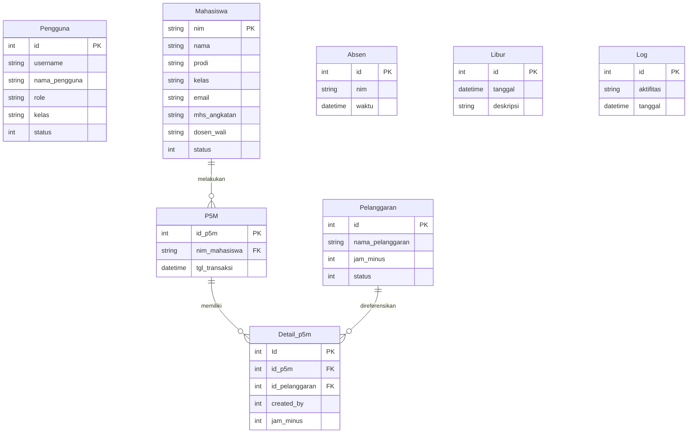

# Sistem Monitoring P5M & Absensi Mahasiswa Manajemen Informatika

[](https://dotnet.microsoft.com/)
[](https://learn.microsoft.com/en-us/aspnet/core/mvc/overview)
[](https://learn.microsoft.com/en-us/dotnet/csharp/)
[](https://www.nuget.org/packages/Microsoft.EntityFrameworkCore)
[](https://www.microsoft.com/en-us/sql-server/)
[](https://getbootstrap.com/)
[](https://www.polytechnic.astra.ac.id/)

Sistem informasi berbasis web yang dikembangkan menggunakan **ASP.NET Core 6.0 MVC** untuk memonitor, mencatat, dan mengelola rekapitulasi **P5M** (*Pembinaan Mental, Moral, Magang, dan Manufaktur / Tata Tertib Kedisiplinan*) serta absensi kehadiran harian mahasiswa **D3 Manajemen Informatika Politeknik Astra**.

Sistem ini dilengkapi integrasi log absensi biometrik mesin **Fingerspot**, sinkronisasi REST API **Sistem Informasi Akademik (SIA) Politeknik Astra**, kalkulasi otomatis denda **Jam Minus**, visualisasi analitik interaktif, serta rekapitulasi pelaporan terpadu.

---

## 📺 Demo Video

Tonton demonstrasi fitur dan alur kerja aplikasi pada video berikut:

[](https://www.youtube.com/watch?v=34R_qu_nPm0)

> *Klik gambar di atas untuk membuka video demo aplikasi di YouTube.*

---

## 📌 Latar Belakang & Konteks P5M

Di lingkungan **Politeknik Astra**, budaya kedisiplinan industri diterapkan secara terstruktur melalui program **P5M** dan aturan jam kerja industri (**07:30 – 16:30 WIB**). Mahasiswa dituntut mematuhi standar etika, kelengkapan atribut seragam/APD, dan kepatuhan kehadiran:
- Setiap pelanggaran tata tertib (seperti keterlambatan, atribut seragam tidak lengkap, kerapian, etika) dikenakan sanksi berupa bobot **Jam Minus**.
- Mahasiswa yang mengumpulkan akumulasi jam minus wajib melakukan **kompensasi/penggantian jam kerja** sebelum batas waktu yang ditentukan sebagai syarat mengikuti ujian semester dan yudisium kelulusan.
- **Tantangan sebelumnya:** Pencatatan manual menimbulkan risiko human error, pelaporan lambat, dan ketidaksesuaian antara data absensi mesin fingerprint dengan rekap tata tertib.
- **Solusi aplikasi:** Mendigitalkan pencatatan harian per kelas, membaca log mesin absensi Fingerspot secara otomatis via Excel, menerapkan *rules engine* perhitungan jam minus secara presisi, serta menyajikan audit trail dan pelaporan eksekutif yang transparan.

---

## ✨ Fitur-Fitur Utama

### 1. Autentikasi Berbasis Peran & Single Sign-On (SSO)
- **Multi-Role Access Control**:
  - `KOORDINATOR SOP dan TATIB`: Administrator utama dengan akses penuh ke seluruh kelas, manajemen data master (Pengguna, Pelanggaran, Mahasiswa, Hari Libur), import log absensi, dan audit log.
  - `SEKRETARIS PRODI`: Hak akses pemantauan rekapitulasi jam minus, audit log absensi, dan laporan lintas kelas.
  - `PENANGGUNG JAWAB / ADMIN KELAS`: Akses terisolasi untuk input dan monitoring P5M harian pada kelas masing-masing.
- **SSO Role Switcher**: Pengguna dengan hak multi-role dapat beralih peran dengan aman via antarmuka `/Login/SSO`.
- **Cookie Authentication & Session Management**: Proteksi endpoint dengan timeout sesi 60 menit dan enkripsi claim identitas.

### 2. Dashboard Eksekutif & Visualisasi Analitik
- **Indikator Real-Time**: Status pengingat P5M harian (*"Sudah P5M Hari Ini"* / *"Belum P5M Hari Ini"*) dan penanda waktu terakhir import data kehadiran.
- **Statistik Pelanggaran Interaktif**: Grafik rekapitulasi jenis pelanggaran yang paling sering dilakukan dengan filter rentang dinamis (*Today*, *This Month*, *This Year*).
- **Top 5 Pelanggar Terbanyak**: Chart peringkat NIM mahasiswa dengan total pelanggaran tertinggi untuk intervensi pembinaan dosen wali.
- **Recent Activity Audit Trail**: Log riwayat aktivitas pengguna yang dapat diunduh langsung menjadi file teks (`sistemP5M_aktifitas.txt`).

### 3. Matriks Pencatatan P5M Harian
- **Input Matrix Terstruktur**: Form checklist dinamis yang memetakan seluruh mahasiswa aktif pada kelas terpilih terhadap seluruh master jenis pelanggaran aktif.
- **Pencegahan Data Ganda (`CheckRecordExistence`)**: Validasi otomatis per mahasiswa, per jenis pelanggaran, dan per tanggal transaksi.
- **Sinkronisasi Otomatis**: Integrasi API SIA memastikan daftar mahasiswa selalu akurat per angkatan dan konsentrasi keahlian.

### 4. Engine Absensi & Integrasi Biometrik Fingerspot
- **Import File Log Excel**: Pemrosesan berkas rekap absensi mesin Fingerspot (`.xlsx` / `.xls`) secara asinkron menggunakan `ExcelDataReader` dan `System.Data.OleDb`.
- **Deteksi Duplikasi**: Verifikasi NIM dan cap waktu presisi untuk memastikan tidak ada pencatatan ganda.
- **Real-Time Import Tracker**: Pelacakan status baris data yang sedang diproses (*batch insert tracking*).

### 5. Aturan Bisnis Jam Minus Otomatis (*Rules Engine*)
Sistem menghitung penalti jam minus absensi secara otomatis berdasarkan selisih jam kedatangan dan jam kepulangan:
- **Jam Kerja Baku**: Masuk **07:30:00**, Pulang **16:30:00**.
- **Kalender Hari Libur**: Otomatis mengecualikan tanggal yang tercatat pada master data hari libur nasional atau akademik.

### 6. Pusat Pelaporan & Ekspor Data Terpadu
- **Laporan Jam Minus P5M**: Rekapitulasi total jam minus hasil penegakan tata tertib harian per periode.
- **Laporan Detail Histori P5M**: Rincian per mahasiswa, waktu kejadian, jenis pelanggaran, dan petugas pencatat.
- **Laporan Presensi Kehadiran**: Rekap waktu *In Time* dan *Out Time* harian tiap mahasiswa.
- **Laporan Jam Minus Absensi**: Akumulasi kompensasi jam akibat keterlambatan atau pulang mendahului jadwal.
- **Ekspor Dokumen Multifformat**: Didukung DataTables Buttons (Excel `.xlsx` via JSZip, PDF via pdfmake, Print, dan Copy Clipboard).

---

## ⏱️ Logika Perhitungan Jam Minus (*Business Rules*)

Sistem mengimplementasikan fungsi `HitungJamMinus(inTime, outTime)` dengan formula berikut:

| Kondisi Kehadiran | Parameter Waktu | Konsekuensi Jam Minus |
| :--- | :--- | :--- |
| **Tepat Waktu** | Datang $\le 07:30:00$ & Pulang $\ge 16:30:00$ | **0 Jam Minus** |
| **Terlambat Masuk Ringan** | $0 < \text{Keterlambatan} < 30 \text{ menit}$ (sebelum 12:00) | **+1 Jam Minus** |
| **Terlambat Masuk Sedang/Berat** | $\text{Keterlambatan} \ge 30 \text{ menit}$ (sebelum 12:00) | **$\lceil \Delta \text{Jam} \rceil \times 2$ Jam Minus** |
| **Datang Siang** | Datang setelah jam $12:00:00$ | **+4 Jam Minus** |
| **Pulang Lebih Awal Ringan** | $0 < \text{Selisih Pulang} < 30 \text{ menit}$ (setelah 12:00) | **+1 Jam Minus** |
| **Pulang Lebih Awal Sedang/Berat** | $\text{Selisih Pulang} \ge 30 \text{ menit}$ (setelah 12:00) | **$\lceil \Delta \text{Jam} \rceil \times 2$ Jam Minus** |
| **Pulang Pagi** | Pulang sebelum jam $12:00:00$ | **+4 Jam Minus** |

---

## 🏗️ Arsitektur & Tumpukan Teknologi

```
┌─────────────────────────────────────────────────────────────┐
│                       PRESENTATION LAYER                    │
│   ASP.NET Core 6.0 MVC Views (Razor), Bootstrap 5,         │
│   NiceAdmin Template, jQuery, DataTables.net, ApexCharts    │
└──────────────────────────────┬──────────────────────────────┘
                               │ HTTP / Razor Pipeline
┌──────────────────────────────▼──────────────────────────────┐
│                       APPLICATION LAYER                     │
│   Controllers: Home, Login, P5M, Mahasiswa, Pelanggaran,    │
│   Pengguna, Libur | Session & Cookie Auth Middleware        │
└──────────────────────────────┬──────────────────────────────┘
                               │
            ┌──────────────────┴──────────────────┐
            ▼                                     ▼
┌───────────────────────────┐         ┌───────────────────────┐
│     EXTERNAL INTEGRATION  │         │      DATA ACCESS      │
│  Politeknik Astra SIA API │         │  EF Core 6.0 (MSSQL)  │
│  ExcelDataReader / OleDb  │         │  ADO.NET / SqlClient  │
└───────────────────────────┘         └───────────┬───────────┘
                                                  │
                                      ┌───────────▼───────────┐
                                      │   SQL SERVER DATABASE │
                                      │  Tables & Procedures  │
                                      └───────────────────────┘
```

- **Framework**: .NET 6.0 (C# 10)
- **Web Engine**: ASP.NET Core MVC
- **ORM**: Entity Framework Core 6.0.25 (SQL Server Provider)
- **Database Engine**: Microsoft SQL Server
- **Excel Ingestion**: `ExcelDataReader` 3.6.0, `EPPlus` 6.2.15, `LinqToExcel` 1.11.0, `System.Data.OleDb`
- **UI & Front-End**: Bootstrap 5, NiceAdmin, SweetAlert2, DataTables Buttons (JSZip, pdfmake), ApexCharts, Chart.js
- **API Client**: `System.Net.Http.HttpClient` dengan `Newtonsoft.Json`

---

## 🗄️ Skema Database

Entity Framework Core mengelola entitas tabel utama pada konteks `ApplicationDbContext`:



---

## 📁 Struktur Direktori

```
P5M_ASP/
├── P5M.sln                       # Solution File Visual Studio
├── README.md                     # Dokumentasi Proyek
└── P5M/                          # Direktori Project Utama ASP.NET Core
    ├── Controllers/              # Controller MVC
    │   ├── HomeController.cs     # Dashboard, ringkasan grafik, audit log, upload absensi
    │   ├── LiburController.cs    # CRUD kalender hari libur nasional & akademik
    │   ├── LoginController.cs    # Login, SSO role selector, logout, cookie auth
    │   ├── MahasiswaController.cs# Integrasi API data mahasiswa & manajemen lokal
    │   ├── P5MController.cs      # Core rules engine P5M, rekapitulasi, & kalkulasi jam minus
    │   ├── PelanggaranController.cs # CRUD data master pelanggaran tata tertib
    │   └── PenggunaController.cs # CRUD akun sistem, penetapan role & kelas
    ├── Models/                   # Entitas Database & ViewModels
    │   ├── AbsensiModel.cs       # Model rekaman raw log mesin biometrik
    │   ├── AbsensiViewModel.cs   # DTO rekap kehadiran (InTime, OutTime)
    │   ├── ApplicationDbContext.cs# EF Core DbContext mapping
    │   ├── DetailP5mModel.cs     # Detail relasi P5M ke jenis pelanggaran
    │   ├── LiburModel.cs         # Master tanggal libur
    │   ├── LogModel.cs           # Audit trail aktivitas pengguna
    │   ├── MahasiswaModel.cs     # DTO / Entitas data mahasiswa
    │   ├── P5MModel.cs           # Header transaksi P5M harian
    │   ├── PelanggaranModel.cs   # Master jenis & poin jam minus pelanggaran
    │   └── PenggunaModel.cs      # Akun, role, dan pembagian kelas
    ├── Views/                    # Razor Views (.cshtml)
    │   ├── Home/                 # Tampilan Dashboard, Grafik, Partial Charts
    │   ├── ImportAbsen/          # Tampilan antarmuka upload log absensi
    │   ├── Laporan/              # Antarmuka laporan & partial views ekspor
    │   ├── Libur/                # Tampilan CRUD data hari libur
    │   ├── Login/                # Halaman login & SSO switch role
    │   ├── Mahasiswa/            # Tampilan data mahasiswa
    │   ├── P5M/                  # Form matriks input & histori P5M
    │   ├── Pelanggaran/          # Tampilan kelola master pelanggaran
    │   ├── Pengguna/             # Tampilan kelola master pengguna
    │   └── Shared/               # Layout master (_LayoutAdmin, Navbar, Sidebar)
    ├── wwwroot/                  # Static Assets (CSS, JS, Vendor NiceAdmin, Libs)
    ├── appsettings.json          # Konfigurasi runtime & Connection String
    ├── Program.cs                # Entry point, dependency injection, & middleware
    └── P5M.csproj                # Definisi proyek & paket NuGet
```

---

## 🚀 Panduan Instalasi & Menjalankan Proyek

### Prasyarat Sistem
Pastikan perangkat Anda telah terpasang komponen berikut:
1. [.NET 6.0 SDK](https://dotnet.microsoft.com/download/dotnet/6.0)
2. [Visual Studio 2022](https://visualstudio.microsoft.com/) (dengan workload *ASP.NET and web development*) atau [Visual Studio Code](https://code.visualstudio.com/) dengan C# Dev Kit.
3. [Microsoft SQL Server](https://www.microsoft.com/en-us/sql-server) (2016 atau versi lebih baru / Express Edition).
4. [SQL Server Management Studio (SSMS)](https://learn.microsoft.com/en-us/sql/ssms/download-sql-server-management-studio-ssms).
5. [Microsoft Access Database Engine 2010/2016](https://www.microsoft.com/en-us/download/details.aspx?id=54920) (Diperlukan oleh driver OLEDB untuk membaca file Excel).

### Langkah-Langkah Menjalankan

1. **Clone Repositori**:
   ```bash
   git clone https://github.com/FarhanAdiyasa/P5M_ASP.git
   cd P5M_ASP
   ```

2. **Konfigurasi Database Connection**:
   Buka file `P5M/appsettings.json` dan sesuaikan koneksi SQL Server dengan server lokal Anda:
   ```json
   {
     "ConnectionStrings": {
       "DefaultConnection": "Server=localhost;Database=fingerspot;Trusted_Connection=True;MultipleActiveResultSets=true;TrustServerCertificate=True;",
       "ExcelConString": "Provider=Microsoft.ACE.OLEDB.12.0;Data Source={filePath};Extended Properties='Excel 12.0;HDR=YES;IMEX=1;'"
     }
   }
   ```

3. **Inisialisasi Database**:
   Jalankan migrasi atau eksekusi pembentukan tabel database melalui Package Manager Console di Visual Studio:
   ```powershell
   Update-Database
   ```
   *Atau menggunakan CLI:*
   ```bash
   dotnet ef database update --project P5M
   ```
   > **Catatan Stored Procedure / Function:** Pastikan function `dbo.GetNimPelanggaran(@startDate, @endDate)` telah dibuat pada database `fingerspot` untuk mendukung visualisasi Top 5 Pelanggar pada dashboard.

4. **Restore Dependency & Build**:
   ```bash
   dotnet restore
   dotnet build
   ```

5. **Jalankan Aplikasi**:
   ```bash
   dotnet run --project P5M
   ```
   Aplikasi akan berjalan secara lokal pada port default (misal: `https://localhost:7001` atau `http://localhost:5000`). Buka browser dan arahkan ke alamat tersebut.

---

## 👥 Hak Akses & Pengujian Awal

Saat aplikasi pertama kali dijalankan, pengguna dapat masuk menggunakan akun yang terdaftar pada tabel `Pengguna`:
- **Koordinator SOP & Tatib**: Akses penuh ke seluruh menu (Dashboard, Pengguna, Libur, Mahasiswa, Import Absensi, Pelanggaran, History P5M).
- **Sekretaris Prodi**: Akses pelaporan dan pemantauan lintas kelas.
- **PJ Kelas**: Terbatas pada pengisian form P5M dan pengecekan histori kelas terkait.

---

## 👨‍💻 Pengembang

**Farhan Adiyasa**  
*Manajemen Informatika — Politeknik Astra*  
- GitHub: [@FarhanAdiyasa](https://github.com/FarhanAdiyasa)

---

## 📄 Lisensi

Proyek ini didistribusikan untuk keperluan akademik dan manajemen kedisiplinan program studi. Seluruh hak cipta modul integrasi dan template mengacu pada ketentuan internal **Politeknik Astra**.
